# 백엔드 설계서 v2

데이터셋 v2.1 반영 · MVC 설계 · 다이어그램 (기준일 2026-10-20)

> **상태 (2026-10-20):** **B0(데이터셋 정렬)를 구현했다.** V2 마이그레이션, 데이터셋 v2.2 시드 교체, 스텁 계약 갱신, 테스트 49건이 끝났고,
> 커밋·푸시는 아직 하지 않았다. 업무 로직, 인증, RabbitMQ, SSE 중계는 아직 구현 전이다 (B1 이후).
> 이 문서의 구조·클래스·다이어그램은 **목표 설계**이고, 현재 코드와의 차이는 아래 "구현 현황"을 본다.
> 다이어그램 원본은 [diagrams/](diagrams/)에 있다 (`.mmd` 소스 + `.png`).

## 구현 현황 (2026-10-20)

| 영역 | 상태 | 비고 |
| --- | --- | --- |
| DB 스키마 (V1 + V2) | **구현·검증 완료** | 데이터셋 13개 테이블과 컬럼·제약·인덱스까지 동일 (184줄 일치), 일반 권한 계정 적용 확인 |
| V1 → V2 업그레이드 | **구현·검증 완료** | V1 데이터가 있는 DB에서도 적용 (`MigrationUpgradeTests`) |
| 시드 (데이터셋 v2.2) | **구현·검증 완료** | 원본과 바이트 단위로 동일, `demo` 프로파일, RFQ 원문 파일 배치 |
| REST API 계약 | **스텁** | 화면용 11개, 내부용 14개 엔드포인트. 응답은 정답지 JSON으로 생성, 고객용·담당자용 견적 응답 분리 |
| JSON 필드명 | **구현·검증 완료** | snake_case. 런타임과 Swagger 문서의 일치를 테스트가 확인 |
| 도메인 enum, 오류 코드 | **구현 완료** | `TaskStatus`, `QuoteStatus`, `AgentStep`, `ErrorCode`, `ApiException` 등 |
| 메시지 규약 | 계약만 정의 | 임베딩 큐 추가. 발행·소비 코드 없음 |
| Entity, Service, Repository | **미구현** | B1 |
| 인증·인가 (JWT, 내부 키, 역할별 응답 실제 적용) | **미구현** | B3. 지금은 모든 엔드포인트가 열려 있다 |
| SSE 중계, Agent 호출, RabbitMQ, 임베딩 파이프라인 | **미구현** | B1~B2. SSE는 고정 이벤트 스트림 스텁 |
| 테스트 | **49건 통과** | 정답지 정합 9, 시드 시나리오 13, API 계약 18, 스키마·SQL 패턴 8, 업그레이드 1 |

## 목차

1. [데이터셋 v2.1 점검 결과](#1-데이터셋-v21-점검-결과)
2. [현재 백엔드와의 차이와 조치](#2-현재-백엔드와의-차이와-조치)
3. [해야 할 일](#3-해야-할-일)
4. [아키텍처](#4-아키텍처)
5. [MVC 설계](#5-mvc-설계)
6. [데이터 설계](#6-데이터-설계)
7. [동작 설계](#7-동작-설계)
8. [결정이 필요한 항목](#8-결정이-필요한-항목)

---

## 1. 데이터셋 v2.1 점검 결과

대상: `개인폴더/Input/rfq_dataset` (README에 "DB v2.1 최종"으로 표기).

### 1.1 변경 요약

| 항목 | 이전 | v2.1 |
| --- | --- | --- |
| 테이블 수 | 7 + doc_chunks | **13개** (companies, users, models, parts, options, model_options, bom, inventory, part_substitutes, rfqs, rfq_reviews, quotes, doc_chunks) |
| 사용자 | 없음 | `companies`(CUSTOMER / SUPPLIER) + `users`(login_id, BCrypt, user_type CUSTOMER / MANAGER). 데모 계정 `hb_buyer01`, `ds_sales01` |
| RFQ | 파일만 | `rfqs`: rfq_number(필수), file_path, 상태 RECEIVED / IN_REVIEW / QUOTED, **추출 컬럼**(eau, sample_qty, sample_due_date, sop_date, target_price_krw, quote_due_date) |
| 분석 결과 | `rfq_reviews`(간단) | `rfq_reviews`: **thread_id**(LangGraph 실행 ID), status RUNNING / WAITING / DONE, SG1(issues, assumptions, confirmed_by, customer_questions, contract_risks) + SG2(shortages, alternatives, recommended_alt) |
| 견적 | 없음 | `quotes`: quote_id(`Q-2026-1019-001`), unit_price(고객 공개), parts_cost · margin_pct · checks(**내부용**), price_by_year, conditions, 상태 DRAFT / APPROVED / REJECTED / REGISTERED, approved_by |
| 임베딩 | 1536차원 | **bge-m3 1024차원**, HNSW 인덱스, embedding_status(PENDING / DONE / FAILED), embedding_model, embedded_at, content_hash |
| 청크 | 22개 | **26개** (영업 규정 6개 → 10개) |
| 규정 | 제10~15조 | + **제16조 견적 마진(30% 이상)**, **제17조 견적서 형식**, 제20조 신규 공급사 부품, 제21조 대체 부품 원가 |
| 규칙 | 계약 한도 5개 | + `payment_days`(제15조), **`quote_margin`**, **`quote_format`** |
| 대안 유형 | 3개 | **4개**: WAIT_INCOMING / PARTIAL_DELIVERY / SUBSTITUTE_PART / NEW_ORDER |
| 신규 파일 | | `rfq_db_v2.dbml`, `03_doc_chunks.sql`, `데이터 설명.md` |

### 1.2 검증 결과 (실제로 적재해서 확인)

| 점검 | 결과 |
| --- | --- |
| 스키마·시드·청크 SQL 적재 (pgvector/pgvector:pg16) | 성공. 테이블 13개, 행 수가 README와 일치 (companies 2, users 2, models 3, options 2, model_options 3, parts 9, bom 12, inventory 9, part_substitutes 1, rfqs 1, doc_chunks 26) |
| 정답 재현 | EWP-12-B + OPT-HT + OPT-IP9K = **37,300원** / 무게 0.75kg / 소음 43dB |
| 부품 원가 (제16조 기준) | 옵션 적용 BOM 6개 부품 합계 **21,650원** → 1년차 마진 **42.0%** |
| 부족 시나리오 | P-MCU-G1 가용 1,500 → 시작품 2,000개에 **500개 부족**, 입고 2027-01-20 (납기보다 늦음) |
| 대체 부품 | P-MCU-G1 → P-MCU-G1-ALT, 검증 14일, 핀 호환, 근거 청크 `alt-002` |
| 청크 해시 | 26개 모두 `content_hash` = SHA-256(content). jsonl과 SQL 일치 |
| 청크와 원문 | 모든 청크가 원문에 그대로 포함, 모든 섹션이 청크로 존재, 데모 필수 청크 8개 존재 |
| 추출 양식과 정답 | `rfq_schema.json`과 `1_parsed_rfq.json`의 키가 정확히 일치 (payment_days 포함) |
| 이슈 | 7건 (HIGH 1건), 통과 항목 4건 |
| 데모 계정 | BCrypt 해시가 `demo1234`로 검증됨 |
| 시퀀스 | 시드가 `setval`로 시퀀스를 맞춰 신규 INSERT가 충돌하지 않음 |

### 1.3 우리가 요청했던 것의 반영 현황

| 요청 | 결과 |
| --- | --- |
| `part_substitutes` 정식 추가 | **반영** (validation_days, pin_compatible, ref_chunk_id) |
| 결제 조건 규칙 | **반영** (`commercial.payment_days`, 제15조 한도 90일) |
| 마진 기준 | **반영** (제16조 + `quote_margin`) |
| 보고서(견적서) 양식 | **반영** (제17조 + `quote_format`) |
| rfq_reviews ↔ rfq_number 문자열 연결 | **반영** (FK 없음) |
| 임베딩 컬럼과 파이프라인 | **반영** (embedding_status 등, "AI 서버 /embeddings로 채운다") |
| 타 공급처 | **해결 (v2.2).** "타 공급처"는 `NEW_ORDER`가 아니라 **`SUBSTITUTE_PART`**(대체 부품, 라벨 "대체 부품 (타 공급처)")이다. `NEW_ORDER`는 원 공급사 신규 발주(조달 120일, 납기 불가) |
| SG2·SG3·SG4 정답지 | **해결 (v2.2).** `5_sg2_supply.json`, `6_sg3_quote.json`, `7_sg4_register.json` 추가 |
| 연간 인하 횟수, `quote_id` 규칙, `alternatives`·`price_by_year`·`conditions`·`checks` 구조 | **해결 (v2.2).** 인하 5번(6년차 마진 32.4%), `quote_id`는 발행일 + 그날 일련번호를 Spring이 생성, 구조는 정답지와 `rules.yaml`에 정의 |
| 구매요청 | **테이블 없음.** 데이터셋 담당 답변: 의도한 제외가 아니라 **빠진 것**이라 **결정이 필요** |

### 1.4 데이터 쪽 남은 이슈

| 이슈 | 영향 |
| --- | --- |
v2.2에서 정답지, 구조, 인하 횟수, `quote_id` 규칙은 **해결**됐다. 남은 것:

| 이슈 | 영향 |
| --- | --- |
| **구매요청 테이블이 없다** (빠진 것이고 결정 필요) | 원래 과제 정의는 "내부 견적과 구매요청 등록". 포함하면 V3로 테이블과 API 추가 |
| **`quotes`에 컬럼이 없는 견적 필드** (`recipient`, `item`, `incoterms`, `issue_date`, `price_breakdown`, `parts_cost_breakdown`) | 견적 초안 요청에는 오지만 저장하지 않는다. `rfqs`·카탈로그·발행 시각으로 다시 만들 수 있다. 저장 위치 협의 필요 |
| **임베딩 API 보완 4가지** | 데이터셋 담당이 "형식은 좋다, 보완 4가지"라고 답함. 내용 확인 필요 |
| `rfqs.file_path` 저장소 | **해결:** 백엔드가 업로드 원문을 `RFQ_FILES_DIR` 아래에 두고, Agent는 `/internal/rfqs/{no}/content`로 받는다 (데이터셋 담당 확인) |

---

## 2. 현재 백엔드와의 차이와 조치

### 2.1 V1이 이미 푸시되어 V2로 정렬했다 (구현 완료)

`git log origin/main`이 로컬 `HEAD`와 같다 (ahead 0, behind 0). V1은 팀원 DB에 이미 적용되었을 수 있으므로 **V1은 수정할 수 없고, V2 마이그레이션으로 정렬해야 한다.**
현재 DB의 데이터는 데모용이라 V2는 변경이 큰 테이블을 **삭제 후 재생성**한다. 대신 팀원 로컬은 V2 적용 후 데모 데이터를 다시 적재해야 한다.

**구현 결과:** `V2__align_dataset_v2.sql`. 데이터셋 테이블 정의는 `01_schema.sql`에서 스크립트로 추출해서 수정 없이 옮겼고, 결과 스키마가 데이터셋과 **컬럼·제약·인덱스까지 동일**함을 확인했다 (184줄 일치).
비교 과정에서 V1과의 차이 2가지(`validation_days` 기본값, `inventory` CHECK)를 찾아 V2에 보정했다. 빈 DB와 V1 데이터가 있던 DB 모두에서 적용되고, 일반 권한 계정으로도 적용된다 (`MigrationUpgradeTests`, 실제 compose 확인).

### 2.2 테이블별 조치

| 테이블 | V1 (현재) | v2.1 | V2 조치 |
| --- | --- | --- | --- |
| models, parts, options, model_options | 동일 구조 | 동일 | **유지** (bom 수량 CHECK 정도만 확인) |
| bom, inventory | 거의 동일 | CHECK 추가, incoming 기본값 0 | **ALTER** (CHECK, DEFAULT) |
| part_substitutes | compatibility_note, requires_spec_revalidation | **pin_compatible, ref_chunk_id** | **ALTER** (컬럼 교체) |
| doc_chunks | vector(**1536**), 상태 컬럼 없음 | vector(**1024**), 상태 컬럼 4개, HNSW | **DROP 후 재생성**, rag_reader 권한 재부여 |
| users | email, role, company(문자열) | login_id, company_id, user_type | **DROP 후 재생성** |
| companies | 없음 | 신규 | **CREATE** |
| rfqs | title, content(원문), 6개 상태 | rfq_number, file_path, 3개 상태, 추출 컬럼 | **DROP 후 재생성** |
| rfq_reviews | 간단한 기록용 | thread_id, status, SG1 + SG2 전체 | **DROP 후 재생성** |
| quotes | 분석 결과당 1건, quote_items | quote_id 문자열, DRAFT→REGISTERED, 내부 필드 | **DROP 후 재생성** (quote_items 삭제) |
| analysis_results, approvals | 백엔드 자체 설계 | 해당 없음 (rfq_reviews, quotes가 대체) | **DROP** |
| purchase_requests, purchase_request_items | 백엔드 자체 설계 | 해당 없음 | **DROP** (구매요청 범위 결정 후 재검토) |
| registration_requests | 단계별 멱등 | 해당 없음 | **DROP** (quotes의 조건부 UPDATE로 대체) |
| ai_tasks | 백엔드 자체 | 해당 없음 | **재생성** (rfq_number FK, quotes와 무관). 비동기 추적·SSE·멱등 키용으로 유지 |
| processed_messages | 백엔드 자체 | 해당 없음 | **유지** (RabbitMQ 소비자 멱등) |
| quote_daily_seq | 없음 | 해당 없음 | **신규** (quote_id 일별 번호) |

**V2 작성 순서:** 의존하는 테이블부터 DROP → CREATE(companies, users, rfqs, rfq_reviews, quotes, ai_tasks, doc_chunks, quote_daily_seq) → part_substitutes, bom, inventory ALTER → `GRANT SELECT ON doc_chunks TO rag_reader`.

### 2.3 시드와 데모 로더

- `db/seed/demo_data.sql`(내가 만든 것)을 **데이터셋의 `02_seed.sql` + `03_doc_chunks.sql`로 교체**한다.
- 데이터셋 시드는 `setval`까지 포함하므로 로더(`DemoDataLoader`)는 그대로 쓰되, "models가 비어 있으면 적재" 조건은 유지한다.
- 데모 계정이 `hb_buyer01`, `ds_sales01`(비밀번호 `demo1234`)로 바뀐다. 인증 구현 시 이 계정으로 로그인 테스트를 한다.

### 2.4 API 계약 변경

**화면용 (`/api/**`)**

| 변경 전 | 변경 후 | 이유 |
| --- | --- | --- |
| `POST /api/rfqs` JSON(title, content, rfqNumber?) | **multipart**(file, **rfqNumber 필수**) | 데이터셋은 RFQ가 파일(`file_path`)이고 `rfq_number`가 필수 |
| `GET /api/rfqs/{id}/analysis` (version, alternatives 3종) | review + 견적 초안 구성. 대안 **4종**. **MANAGER 전용** | `rfq_reviews`는 내부용(고객 노출 금지) |
| `POST .../approval` {decision, comment, **resultVersion**} | {**quoteId**, decision, **reason**, returnToStep?} | 승인 단위가 `quotes`이고, 재생성 시 새 `quote_id`가 생김 |
| (없음) | `POST /api/auth/login`, `GET /api/me` | users가 login_id 기반으로 바뀜 |
| (없음) | `GET /api/rfqs/{id}/quotes` | **CUSTOMER는 REGISTERED 견적만, 내부 필드 제외** |

**내부용 (`/internal/**`)**

| 변경 | 내용 |
| --- | --- |
| **삭제** | `POST /analysis-results`, `POST /purchase-requests`, `GET /registrations/{id}`, 기존 `POST /quotes`(등록용) |
| **신규** | `GET /rfqs/{no}`, `GET /rfqs/{no}/content`, `PATCH /rfqs/{no}`(추출 컬럼 + 상태) |
| **변경** | `POST /rfq-reviews` → **`PUT /rfq-reviews`** : `(rfqNumber, threadId)`로 upsert, **전달된 섹션만 갱신** (SG1이 쓰고 SG2가 이어서 쓴다) |
| **신규** | `POST /quotes`(DRAFT 생성, quote_id는 서버가 생성), `PATCH /quotes/{id}`(DRAFT 동안 checks·conditions 갱신), `POST /quotes/{id}/register`(APPROVED → REGISTERED, **멱등**) |
| **신규** | `POST /tasks/{taskId}/events` (진행 이벤트: STEP_START / STEP_END / TOOL_START / TOOL_END / CLARIFICATION_REQUIRED / APPROVAL_REQUIRED) |
| **조정** | `GET /parts/{id}/substitutes`에 `pinCompatible`, `refChunkId`, 대체 부품 가용 재고 포함 |
| 유지 | `/models`, `/models/{id}/bom?options=`, `/parts/{id}`, `/parts/{id}/inventory` |

### 2.5 메시지 규약 변경

| 변경 | 내용 |
| --- | --- |
| 추가 | `document.embed.requested`, 큐 `document.embed.q` + `document.embed.dlq` (임베딩 파이프라인) |
| 유지 | `analysis.requested`, `analysis.resume`, `analysis.completed`, `analysis.failed` |
| 용어 | `analysis.resume.kind` = CLARIFICATION / APPROVED / REJECTED 그대로. 반려 시 복귀 지점은 DB(`quotes.reject_reason`, 승인 요청의 `returnToStep`)에서 읽는다 |

### 2.6 테스트 영향

| 테스트 | 수정 |
| --- | --- |
| `SupplyquoteBackendApplicationTests` | 테이블 목록(13개 + ai_tasks, processed_messages), 1024차원 벡터 |
| `ApiContractTests` | 새 경로, 요청 형식(multipart) |
| `DemoScenarioTests` | 26 청크, companies 2, 마진 계산(원가 21,650, 1년차 42.0%), 대체 부품 `pin_compatible` |

---

## 3. 해야 할 일

### 3.1 백엔드 단계별 계획

| 단계 | 작업 | 산출물 | 규모 |
| --- | --- | --- | --- |
| **B0 (완료)** | V2 마이그레이션 + 시드 교체 + 테스트 갱신 | `V2__align_dataset_v2.sql`, 시드 2개(데이터셋 v2.2 그대로), 테스트 49건 | M |
| **B0 (완료)** | Swagger 스텁 계약 갱신 (2.4 표). 응답은 정답지 JSON에서 생성 | DTO, 컨트롤러 스텁, `stub/*.json` | M |
| **B0 (진행 중)** | **Agent 팀과 계약 합의** (3.3, 8장). 데이터셋 담당과는 1차 합의 완료 | 합의 기록 | S (회의) |
| **B1** | 내부 API **실제 구현**: 모델·옵션 적용 BOM·부품·재고·대체 | CatalogService, InternalCatalogController | M |
| **B1** | RFQ 접수(파일) → `ai_tasks` → Agent 호출 (**먼저 HTTP 동기 호출**) | RfqService, TaskService, AgentClient | M |
| **B1** | `rfq_reviews` upsert, 견적 DRAFT 생성·등록(멱등) | ReviewService, QuoteService | M |
| **B1** | 진행 이벤트 수신 + SSE 중계 | SseHub, EventController | M |
| **B1** | 요구 확인·승인 API (조건부 UPDATE) | 확인·승인 처리 | M |
| **B2** | **RabbitMQ를 B1 흐름 사이에 삽입** (선언, 발행 confirm·mandatory, 소비자, 재시도, **DLQ 소비자**, 점검 작업) | messaging 패키지 | L |
| **B2** | 임베딩 파이프라인 | EmbeddingService, 소비자 | M |
| **B3** | 인증·인가: JWT, 역할별 응답, 내부 키, CORS, SSE 인증 | security 패키지 | M |
| **B4** | 시나리오 통합 테스트, 오류·예외 경로, 관측(trace_url), 문서·발표 정리 | | M |

**순서의 이유:** 팀이 기다리는 것은 내부 API(B1)이고 인증은 다른 팀을 막지 않는다. 그리고 동작하는 흐름(B1)에 큐(B2)를 삽입해야 문제가 생겼을 때 원인을 가릴 수 있다.

### 3.2 Agent 팀에 제공할 것 (Agent별 접점)

MCP 도구 이름은 예시이고, 최종 이름은 MCP·Agent 팀이 정한다. 백엔드가 책임지는 것은 오른쪽 두 열이다.
Agent는 노션 기준 SG1 김지영, SG2 윤서준, SG3 박영신, SG4 신주윤이며 변경될 수 있다.

| Agent | 노드 | 쓰는 MCP 도구 (예시) | 백엔드 API | 백엔드 저장 위치 |
| --- | --- | --- | --- | --- |
| **SG1** | parse_rfq | business.get_rfq_content | `GET /internal/rfqs/{no}/content` | `rfqs` 추출 컬럼 (`PATCH /internal/rfqs/{no}`) |
| | validate_rules | rag.search_docs (근거) | | `rfq_reviews.issues`, `passed_checks` |
| | human_confirm | (사람) | `POST /api/ai/tasks/{id}/confirmation` | `rfq_reviews.assumptions`, `confirmed_by`, `confirmed_at` |
| | match_spec | business.get_models, rag.search_docs | `GET /internal/models` | `rfq_reviews.selected_model`, `options`, `fit_type` |
| | check_contract | rag.search_docs | | `rfq_reviews.contract_risks`, `customer_questions` |
| **SG2** | expand_bom | business.get_bom | `GET /internal/models/{id}/bom?options=` | |
| | check_supply | business.get_inventory, get_part | `GET /internal/parts/{id}/inventory`, `/{id}` | |
| | alternatives | business.get_substitutes, rag.search_docs | `GET /internal/parts/{id}/substitutes` | `rfq_reviews.shortages`, `alternatives`, `recommended_alt` |
| **SG3** | calc_cost, draft_quote | business.get_part, get_models | | `quotes` DRAFT (`POST /internal/quotes`) |
| | validate_quote | rag.search_docs (제16·17조) | | `quotes.checks` (`PATCH /internal/quotes/{id}`) |
| **SG4** | human_approval | (사람) | `POST /api/ai/tasks/{id}/approval` | `quotes.status`, `approved_by`, `reject_reason` |
| | revalidate | business.get_inventory, get_part | (SG2와 동일) | |
| | register | business.register_quote | `POST /internal/quotes/{id}/register` | `quotes.status = REGISTERED`, `rfqs.status = QUOTED` |

모든 Agent 공통: 진행은 `POST /internal/tasks/{taskId}/events`로 알리고, 실행 ID는 `threadId`(백엔드가 생성해서 전달)를 쓴다.
**하네스(Instructions, Tools, Agent Loop, Context, State, Guardrails, Recovery, Observability)는 Agent 서버 내부 영역**이라 백엔드는 `trace_url`(LangSmith 링크) 저장 정도만 연결 지점이다.

### 3.3 Agent 팀과 합의할 것

| # | 항목 | 제안 |
| --- | --- | --- |
| 1 | Agent 실행·재개 API | `POST /runs`, `POST /runs/{threadId}/resume`, 둘 다 202 |
| 2 | 진행 이벤트 경로 | `POST /internal/tasks/{id}/events`, 큐를 거치지 않음 |
| 3 | RFQ 원문 접근 | 내부 API로 조회 (`/content`). 파일을 직접 공유하지 않음 |
| 4 | thread_id 생성 | 백엔드가 `task-{taskId}`로 생성해서 전달 |
| 5 | 쓰기 방식 | 모든 쓰기는 `/internal/**` (MCP·Agent는 DB 직접 쓰기 금지) |
| 6 | 산출 JSON 구조 | alternatives, price_by_year, conditions, checks의 필드 합의 (정답지 포함) |
| 7 | 반려 시 복귀 지점 | `returnToStep` 값 목록 (SG1~SG3 노드 중) |
| 8 | step 이름 | 진행 표시용 (RFQ_ANALYSIS, SPEC_MATCH, SUPPLY_CHECK, ALTERNATIVE_ANALYSIS, QUOTE, FINAL_REVIEW, APPROVAL) |

---

## 4. 아키텍처

### 4.1 시스템 구성도

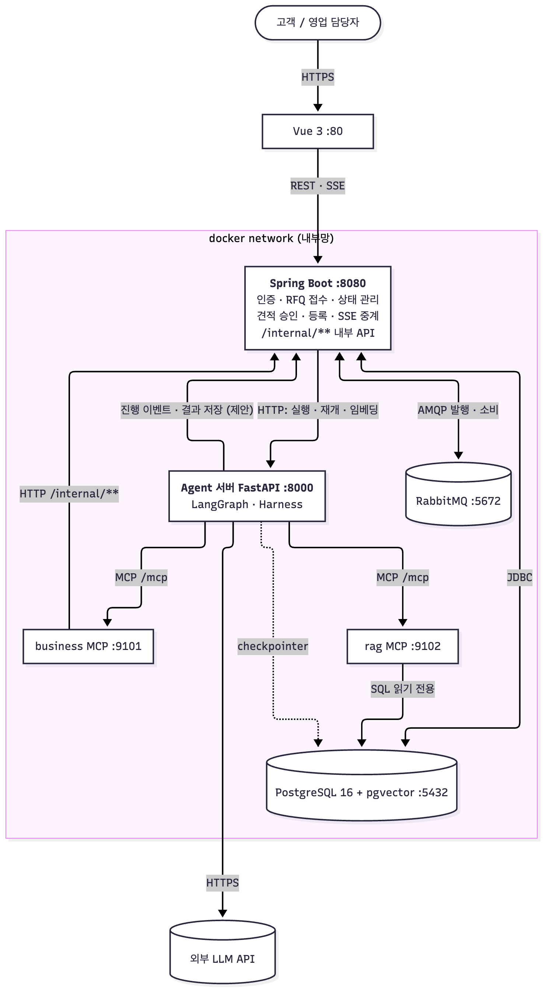

공개 포트는 frontend(80)와 backend(8080)뿐이고, Agent·MCP·PostgreSQL·RabbitMQ는 docker network 안에 둔다.
점선은 제안(Agent→Spring 진행 이벤트 경로, checkpointer)이다.

### 4.2 배포 구성

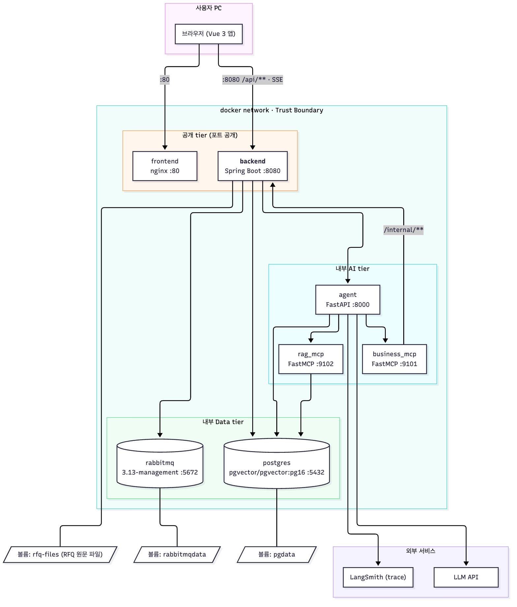

| 서비스 | 포트 | 볼륨 | 비고 |
| --- | --- | --- | --- |
| frontend (nginx) | 80 | | |
| **backend (Spring Boot)** | 8080 | **rfq-files** (RFQ 원문 파일, 신규) | 컨테이너화는 배포 단계 |
| agent (FastAPI) | 8000 | | |
| business_mcp / rag_mcp | 9101 / 9102 | | |
| postgres (pgvector) | 5432 | pgdata | |
| rabbitmq | 5672 (+15672 콘솔) | rabbitmqdata | |

### 4.3 RabbitMQ 토폴로지

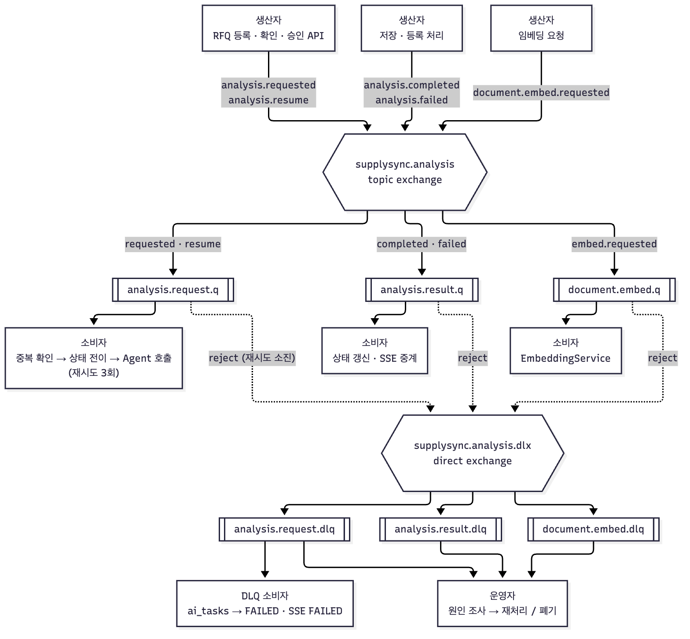

| 큐 | 바인딩 | 소비자 | DLQ 이후 |
| --- | --- | --- | --- |
| analysis.request.q | analysis.requested, analysis.resume | 중복 확인 → 상태 전이 → Agent 호출 (재시도 3회) | **DLQ 소비자**가 `ai_tasks`를 FAILED로 바꾸고 SSE FAILED 전송, 운영자가 재처리/폐기 |
| analysis.result.q | analysis.completed, analysis.failed | 상태 갱신 · SSE 중계 | 운영자 확인 |
| document.embed.q | document.embed.requested | EmbeddingService | 운영자 확인, 청크는 FAILED로 표시 |

---

## 5. MVC 설계

### 5.1 MVC 대응

Spring MVC REST 백엔드에서 MVC는 다음과 같이 대응한다.

| MVC | 이 프로젝트 | 책임 |
| --- | --- | --- |
| **Model** | `domain/` Entity·Enum + DTO | 업무 데이터와 상태 값. Entity는 DB 구조, DTO는 API 계약 |
| **View** | Vue 3 (외부) + JSON/SSE 응답 | 서버는 화면을 만들지 않고 DTO를 직렬화해서 돌려준다 |
| **Controller** | `web/`, `auth/`, `internal/` | 요청 검증, 인증된 사용자 확인, Service 호출, DTO 변환 |
| (Service) | `service/` | **업무 규칙, 트랜잭션, 상태 전이.** Controller와 Repository 사이 |
| (Repository) | `repository/` | DB 접근 |

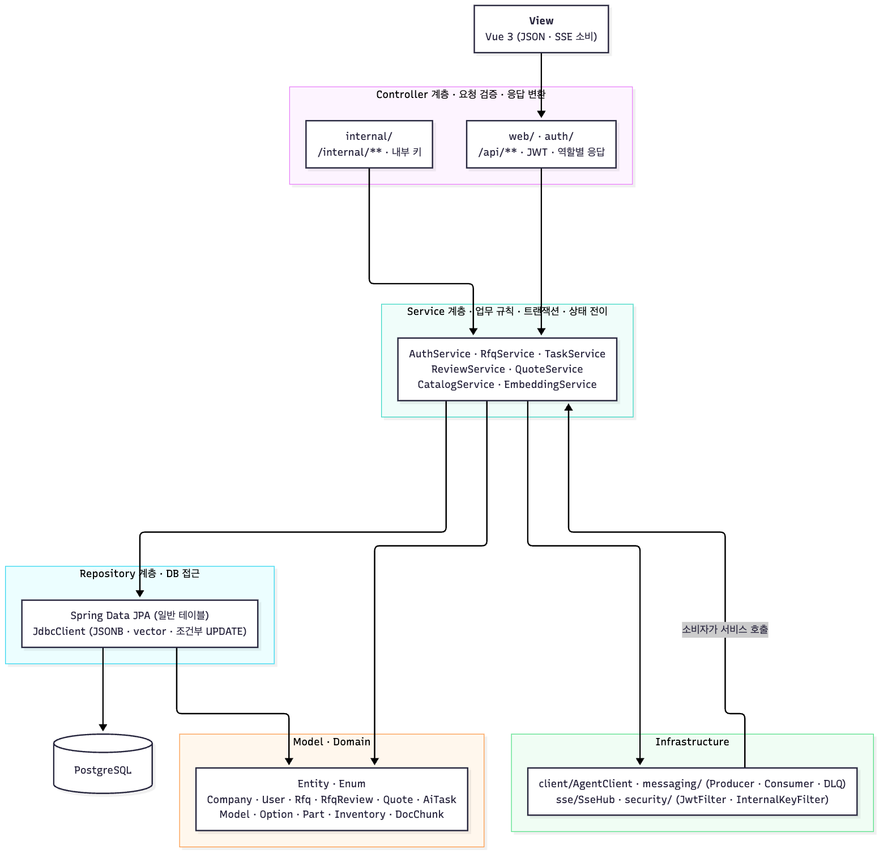

**레이어 규칙**

1. Controller는 **Service만** 호출한다. Repository를 직접 부르지 않는다.
2. **업무 규칙은 Service에만** 둔다 (상태 전이 조건, 승인·등록 검사, 역할별 가시성). Controller와 Repository에 규칙을 넣지 않는다.
3. Entity를 API 응답으로 **직접 반환하지 않는다.** 항상 DTO로 변환한다 (내부용 필드 노출 방지).
4. Repository는 Service만 호출한다. JSONB·vector·조건부 UPDATE는 `JdbcClient`, 일반 CRUD는 Spring Data JPA.
5. 화면용(`web`)과 내부용(`internal`) Controller는 **같은 Service를 공유**한다. 규칙이 한 곳에 있다.
6. 소비자(RabbitMQ)와 스케줄러도 Controller와 같은 **입구**다. Service만 호출한다.
7. 트랜잭션 안에서 **외부 HTTP 호출(Agent)을 하지 않는다.**

### 5.2 패키지 구조

```
com.skala.supplyquote.supplyquote_backend
├─ common/        ErrorResponse, ErrorCode, ApiException, GlobalExceptionHandler
├─ config/        OpenApiConfig, SecurityConfig, WebConfig(CORS), RabbitConfig, AsyncConfig, DemoDataLoader
├─ security/      JwtProvider, JwtAuthFilter, InternalKeyFilter, CurrentUser(@AuthenticationPrincipal)
├─ auth/          AuthController, dto/
├─ web/           RfqController, AiTaskController, QuoteController, dto/        ← /api/**
├─ internal/      InternalRfqController, InternalCatalogController, InternalReviewController,
│                 InternalQuoteController, InternalEventController, dto/        ← /internal/**
├─ service/       AuthService, RfqService, TaskService, ReviewService, QuoteService,
│                 CatalogService, EmbeddingService, FileStorageService, QuoteIdGenerator
├─ domain/        Company, User, Rfq, RfqReview, Quote, AiTask, Model, Option, Part,
│                 Inventory, PartSubstitute, DocChunk  + enum (TaskStatus, QuoteStatus, RfqStatus ...)
├─ repository/    *Repository (JPA), RfqReviewRepository / QuoteRepository / DocChunkRepository (JdbcClient)
├─ client/        AgentClient (RestClient: run, resume, embed)
├─ messaging/     contract/, AnalysisProducer, AnalysisConsumer, ResultConsumer, DlqConsumer, EmbedConsumer
└─ sse/           SseHub (taskId별 emitter, 역할별 필터)
```

현재 코드 대비: `web/`, `auth/`(로그인 스텁), `internal/`, `dto/`(정답지와 같은 공통 구조), `messaging/contract/`, `domain/`(enum), `common/`, `config/`(OpenApiConfig, DemoDataLoader), `stub/`(스텁 재료, 구현되면 삭제)는 **이미 있다.** `service/`, `repository/`, `client/`, `security/`, `sse/`와 `messaging`의 구현은 **아직 없다**(B1 이후).

### 5.3 클래스 구조

**도메인(Model)**

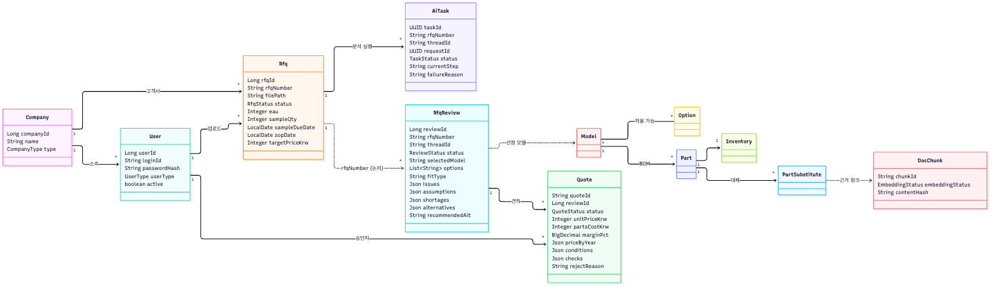

**Controller · Service · Infrastructure**

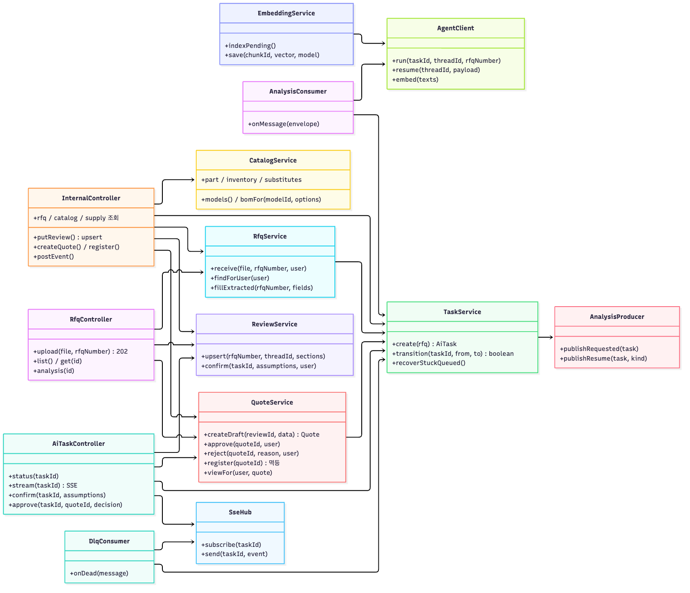

| 클래스 | 책임 |
| --- | --- |
| `RfqService` | RFQ 접수(권한, 파일 저장, `rfqs` + `ai_tasks` 한 트랜잭션), 역할별 목록·상세, 추출 컬럼 갱신 |
| `TaskService` | **상태 전이 단일 창구** (조건부 UPDATE), 오래 QUEUED인 작업 재발행, FAILED 처리 |
| `ReviewService` | `rfq_reviews` upsert(섹션 부분 갱신), 가정 확인 저장(`confirmed_by`) |
| `QuoteService` | 견적 DRAFT 생성, 승인·반려, 등록(멱등), **역할별 뷰 변환** |
| `QuoteIdGenerator` | `Q-YYYY-MMDD-NNN` (일별 시퀀스) |
| `CatalogService` | 모델·옵션 적용 BOM·부품·재고·대체 부품 조회 (가용 재고 = on_hand − allocated를 한 곳에서 계산) |
| `EmbeddingService` | PENDING 청크 배치 → `AgentClient.embed` → 차원 검증 → 저장 |
| `AgentClient` | Agent 서버 호출 (`/runs`, `/resume`, `/embeddings`), 타임아웃·오류 변환 |
| `SseHub` | taskId별 구독 관리, 이벤트 전송, **사용자 역할에 따라 내용 필터** |
| `AnalysisProducer` | 커밋 후 발행, publisher confirm·mandatory 콜백 |
| `AnalysisConsumer` | 중복 확인 → 조건부 상태 전이 → Agent 호출 → ack |
| `DlqConsumer` | DLQ 메시지를 받아 작업 FAILED 처리와 알림 (재큐잉 금지) |

### 5.4 엔드포인트 → Controller → Service → 저장소 추적표

**화면용**

| 엔드포인트 | Controller | Service | 읽고 쓰는 테이블 |
| --- | --- | --- | --- |
| `POST /api/auth/login` | AuthController | AuthService | users, companies |
| `POST /api/rfqs` | RfqController | RfqService, TaskService, AnalysisProducer | rfqs, ai_tasks (쓰기), 파일 저장 |
| `GET /api/rfqs`, `/{id}` | RfqController | RfqService | rfqs (역할별 필터) |
| `GET /api/rfqs/{id}/analysis` | RfqController | ReviewService, QuoteService | rfq_reviews, quotes (**MANAGER**) |
| `GET /api/rfqs/{id}/quotes` | QuoteController | QuoteService | quotes (CUSTOMER는 REGISTERED만 · 내부 필드 제외) |
| `GET /api/ai/tasks/{id}`, `/stream` | AiTaskController | TaskService, SseHub | ai_tasks |
| `POST .../confirmation` | AiTaskController | ReviewService, TaskService, AnalysisProducer | rfq_reviews, ai_tasks |
| `POST .../approval` | AiTaskController | QuoteService, TaskService, AnalysisProducer | quotes, ai_tasks |

**내부용**

| 엔드포인트 | Controller | Service | 테이블 |
| --- | --- | --- | --- |
| `GET /internal/rfqs/{no}`, `/content`, `PATCH` | InternalRfqController | RfqService, FileStorageService | rfqs |
| `GET /internal/models...`, `/parts...` | InternalCatalogController | CatalogService | models, options, bom, parts, inventory, part_substitutes |
| `PUT /internal/rfq-reviews` | InternalReviewController | ReviewService | rfq_reviews |
| `POST /internal/quotes`, `PATCH`, `POST .../register` | InternalQuoteController | QuoteService, TaskService | quotes, rfqs, ai_tasks |
| `POST /internal/tasks/{id}/events` | InternalEventController | TaskService, SseHub | ai_tasks |

### 5.5 역할별 응답 (View 분리)

데이터셋이 정한 가시성 규칙이다. `rfq_reviews`는 내부용이고, `quotes`는 고객이 REGISTERED만 볼 수 있으며 `parts_cost_krw`, `margin_pct`, `checks`는 내부용이다.

| 기능 | CUSTOMER | MANAGER |
| --- | --- | --- |
| RFQ 업로드 | O (자기 회사) | X (대리 등록은 미정) |
| RFQ 목록·상세 | **자기 회사 것만** | 전체 |
| 분석 결과(rfq_reviews) | **X** | O |
| 견적 조회 | **REGISTERED만**, 고객 공개 필드만 | 전체, 내부 필드 포함 |
| 요구 확인, 승인·반려 | X | O |
| 작업 상태·SSE | 자기 RFQ의 **거친 상태만** (분석 중, 완료 등) | 전체 이벤트 (이슈 내용 포함) |

- Entity에서 응답을 만들 때 **역할별 DTO**(`CustomerQuoteView`, `ManagerQuoteView`)로 나눈다. 필드를 숨기는 방식(null 처리)이 아니라 **클래스를 분리**해서 실수로 노출되지 않게 한다.
- SSE의 `CLARIFICATION_REQUIRED`에는 이슈 내용이 담기므로 **MANAGER 구독자에게만** 보낸다.
- 고객 응답에서 남의 회사 RFQ는 **404**로 응답한다 (존재 여부를 알리지 않는다).

### 5.6 트랜잭션과 상태 전이 규칙

상태 전이는 **조건부 UPDATE**로 처리한다. 락 없이 동시성과 멱등을 함께 얻는다. 영향 행 0건이면 "이미 처리됨"이다.

```sql
-- 작업 상태 전이 (TaskService.transition)
UPDATE ai_tasks SET status = :to, updated_at = now() WHERE task_id = :id AND status = :from;

-- 견적 승인
UPDATE quotes SET status = 'APPROVED', approved_by = :user, approved_at = now()
 WHERE quote_id = :id AND status = 'DRAFT';

-- 견적 등록 (멱등): 0건이면 이미 REGISTERED → 200 ALREADY_PROCESSED, 그 외 → 409
UPDATE quotes SET status = 'REGISTERED', registered_at = now()
 WHERE quote_id = :id AND status = 'APPROVED';

-- 분석 결과 upsert (전달된 섹션만 갱신)
INSERT INTO rfq_reviews (rfq_number, thread_id, status, ...) VALUES (...)
ON CONFLICT (rfq_number, thread_id) DO UPDATE SET issues = COALESCE(EXCLUDED.issues, rfq_reviews.issues), ...;
```

| 규칙 | 내용 |
| --- | --- |
| 한 트랜잭션 | `quotes` 상태 변경 + `ai_tasks` 전이 + `rfqs` 상태 갱신은 한 트랜잭션 |
| 발행 시점 | **커밋 후** 발행 (`AFTER_COMMIT`) |
| 외부 호출 | Agent HTTP 호출은 트랜잭션 **밖에서** |
| 소비자 | "처리 + `processed_messages` 기록"을 한 트랜잭션으로, 커밋 후 ack |
| 재생성 | 반려·조건 변경 시 기존 `quotes`는 REJECTED로 두고 **새 `quote_id`의 DRAFT**를 만든다 (이력 보존) |
| 저장 위치 | `quote_id` 생성은 `quote_daily_seq(day, last_seq)` upsert + RETURNING |

### 5.7 오류 코드

| ErrorCode | HTTP | 쓰임 |
| --- | --- | --- |
| VALIDATION_ERROR | 400 | 입력 검증 실패 |
| MALFORMED_REQUEST | 400 | 본문·파일 형식 오류 |
| UNAUTHORIZED | 401 | 토큰 없음·만료, 내부 키 불일치 |
| FORBIDDEN | 403 | 역할 부족 (예: CUSTOMER가 승인 시도) |
| NOT_FOUND | 404 | 없는 리소스, **남의 회사 리소스** |
| CONFLICT_STATE | 409 | 상태 불일치, 이미 처리됨 (더블 클릭, 오래된 quoteId) |
| ALREADY_PROCESSED | 200 | 등록 재시도가 이미 성공한 경우 (오류 아님) |
| AGENT_UNAVAILABLE | 503 | Agent 서버 호출 실패 (재시도 대상) |
| INTERNAL_ERROR | 500 | 그 외 |

### 5.8 인증·인가

| 대상 | 방식 | 필터 |
| --- | --- | --- |
| `/api/**` | JWT (claims: userId, companyId, userType) | `JwtAuthFilter` |
| `/internal/**` | `X-Internal-Api-Key` 헤더와 설정값 비교 | `InternalKeyFilter` |
| `/api/auth/**`, Swagger, `/actuator/health` | 인증 없음 | permitAll |

- 로그인: `login_id` + 비밀번호(BCrypt) 검증 → JWT 발급. 비활성(`is_active=false`) 사용자는 거부한다.
- **회사-역할 규칙**은 애플리케이션에서 검증한다: CUSTOMER는 CUSTOMER 회사, MANAGER는 SUPPLIER 회사 소속 (데이터셋 주석).
- SSE는 브라우저 기본 EventSource가 헤더를 못 보내므로 프론트에서 `fetch-event-source` 계열을 쓰는 안이다 (합의 필요).
- `/internal/**` 호출에는 사용자가 없다. 등록 권한은 **견적이 APPROVED 상태인가**로 판단한다.

---

## 6. 데이터 설계

### 6.1 ERD (데이터셋 v2.1 + 백엔드 테이블)

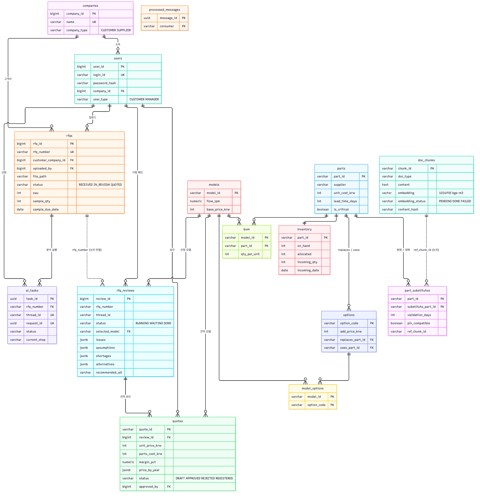

- 데이터셋 13개 테이블에 백엔드 전용 `ai_tasks`, `processed_messages`(+`quote_daily_seq`)를 더한다.
- `rfq_reviews.rfq_number`는 `rfqs.rfq_number`와 **문자열로 연결**(FK 없음)이다. `rfq_reviews.thread_id`와 `ai_tasks.thread_id`가 같은 실행을 가리킨다.
- `ai_tasks`는 비동기 추적(진행 단계, 실패 사유, trace 링크), 멱등 키(`request_id`), 메시지 상태 관리용이다. 데이터셋의 `rfq_reviews.status`(RUNNING / WAITING / DONE)보다 **세분화된 상태**가 화면에 필요해서 유지한다.

### 6.2 상태 머신

**분석 작업 (`ai_tasks.status`)**

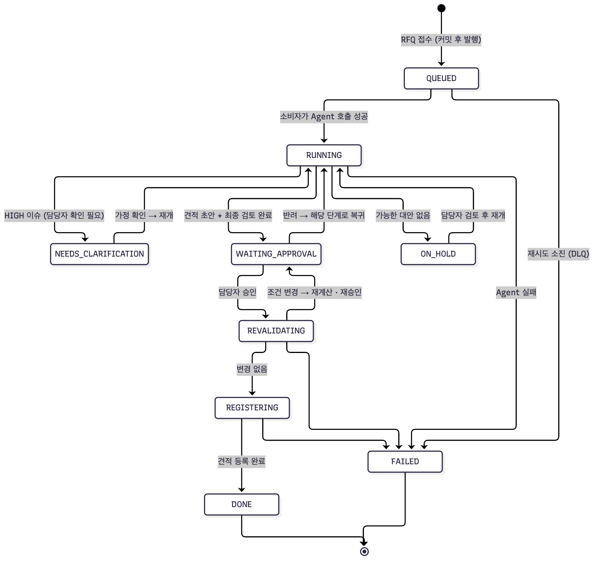

**견적 (`quotes.status`)**

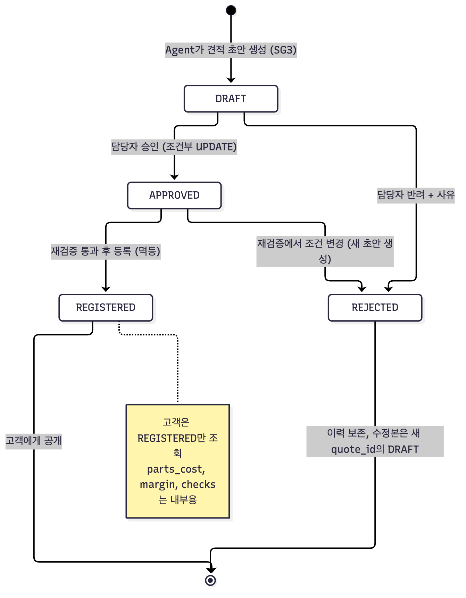

| 대상 | 상태 값 | 비고 |
| --- | --- | --- |
| `ai_tasks.status` | QUEUED, RUNNING, NEEDS_CLARIFICATION, WAITING_APPROVAL, REVALIDATING, REGISTERING, ON_HOLD, DONE, FAILED | 구매요청이 제외되면 PARTIALLY_REGISTERED는 불필요 |
| `quotes.status` | DRAFT, APPROVED, REJECTED, REGISTERED | 데이터셋 정의 |
| `rfqs.status` | RECEIVED, IN_REVIEW, QUOTED | 접수 → 소비자가 Agent 호출 시 IN_REVIEW → 등록 시 QUOTED |
| `rfq_reviews.status` | RUNNING, WAITING, DONE | WAITING은 담당자 입력 대기 |
| `doc_chunks.embedding_status` | PENDING, DONE, FAILED | `content_hash`가 바뀌면 PENDING으로 되돌려 재임베딩 |

---

## 7. 동작 설계

### 7.1 RFQ 접수 → 분석 시작

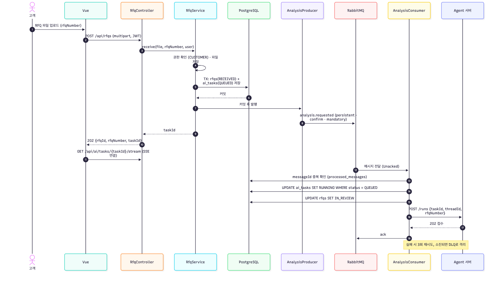

### 7.2 Agent 실행 중 (MCP, 요구 확인, 진행 이벤트)

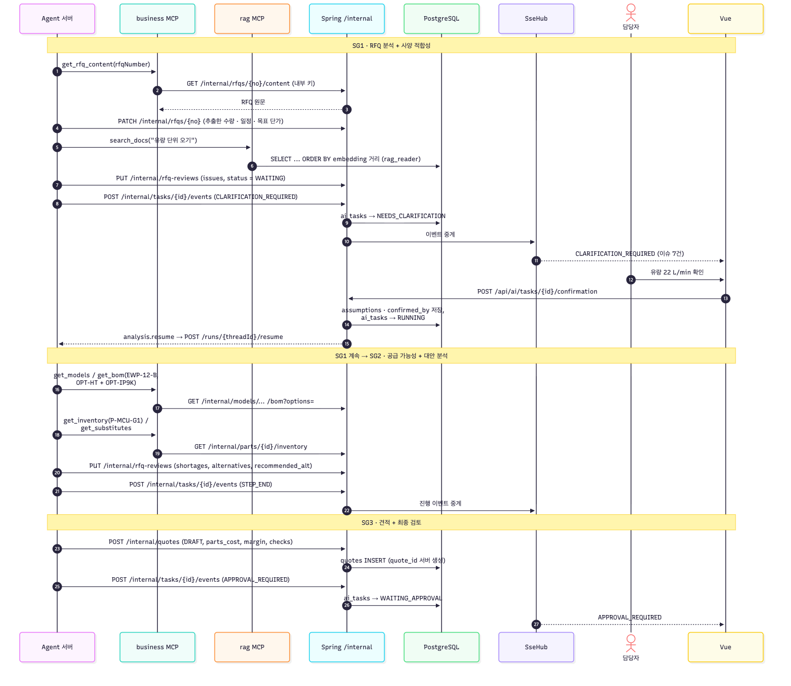

### 7.3 승인 → 재검증 → 등록

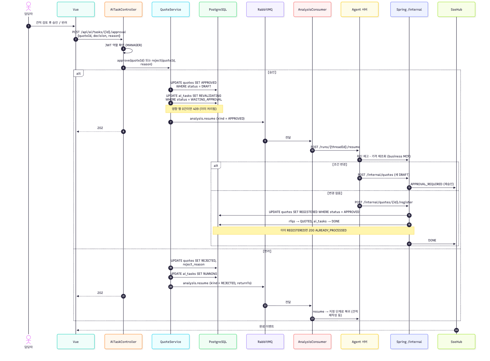

### 7.4 LangGraph 전체 흐름

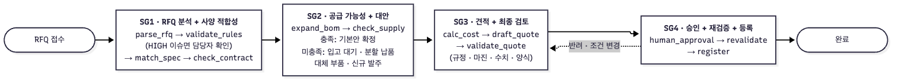

노드 단위 상세는 아래 그림이다. 팀 워크플로의 7단계가 SG1~SG4로 묶인다.

| 팀 워크플로 | 그래프 위치 |
| --- | --- |
| RFQ 분석 Agent (요구사항 추출, 누락·이상값 검증) | SG1 `parse_rfq`, `validate_rules`, `human_confirm` |
| 사양 적합성 Agent (제품·옵션 선정) | SG1 `match_spec`, `check_contract` |
| 공급 가능성 Agent (BOM 전개, 가용 재고, 조달 리드타임) | SG2 `expand_bom`, `check_supply` |
| 대안 분석 Agent (조건부) | SG2 `alternatives` (WAIT_INCOMING / PARTIAL_DELIVERY / SUBSTITUTE_PART / NEW_ORDER) |
| 견적 Agent (비용 계산, 기본안·대안 견적) | SG3 `calc_cost`, `draft_quote` |
| 최종 검토 노드 (규정, 마진, 수치, 양식) | SG3 `validate_quote` |
| 담당자 승인 | SG4 `human_approval` → `revalidate` → `register` |

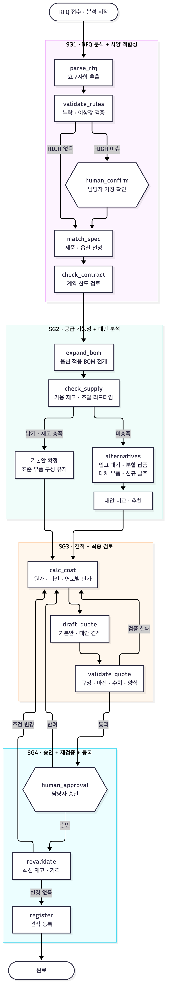

### 7.5 임베딩 적재 파이프라인

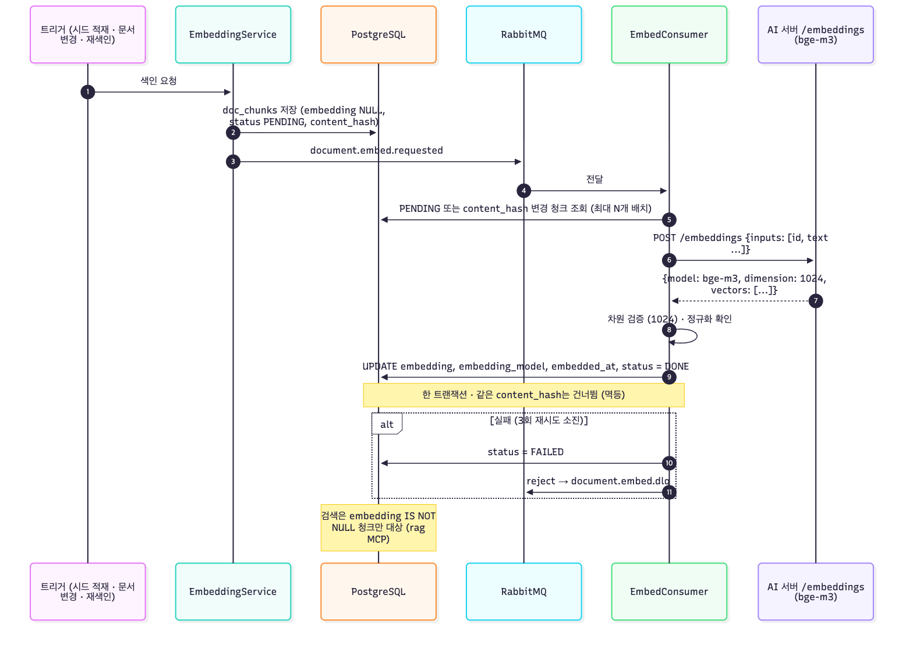

---

## 8. 결정이 필요한 항목

| # | 항목 | 제안 | 상대 |
| --- | --- | --- | --- |
| 1 | **V2 마이그레이션이 데모 데이터를 지워도 되는가** (팀원은 `docker compose down -v` 필요) | 허용. 운영 데이터가 없는 단계 | 팀 |
| 2 | **구매요청을 이번 범위에 포함하는가** (데이터셋 담당: 빠진 것이지 의도한 제외가 아님) | 포함하려면 V3로 테이블·API 추가, 제외하면 개요서에 범위 제외를 명시 | 팀, 지영님 |
| 3 | RFQ 접수 = 파일 업로드. 지원 형식(md만? PDF도?), 프론트의 multipart 연동 | 저장소는 `RFQ_FILES_DIR`로 구현, 우선 md | 이정현, 팀 |
| 4 | ~~`quote_id` 생성 주체와 규칙~~ **해결:** 발행일 + 그날 일련번호, Spring이 생성 | `quote_daily_seq`로 구현 예정 | (해결) |
| 5 | 승인 단위 = `quoteId`, 반려·조건 변경 시 새 `quote_id` | resultVersion 폐기 | Agent 팀 |
| 6 | ~~"타 공급처" = `NEW_ORDER`?~~ **해결:** `SUBSTITUTE_PART`. `alternatives` 구조는 정답지로 확정 | 반영 완료 | (해결) |
| 7 | ~~SG2·SG3 정답지~~ **해결:** `5_sg2_supply.json`, `6_sg3_quote.json`, `7_sg4_register.json` | 시나리오 테스트에 반영 완료 | (해결) |
| 8 | ~~연간 인하 적용 횟수~~ **해결:** 5번 (6년차 마진 32.4%) | 반영 완료 | (해결) |
| 9 | 고객 노출 범위 | CUSTOMER는 REGISTERED 견적만, 진행 이벤트는 거친 상태만 | 팀 |
| 10 | Agent 실행·재개 API, 진행 이벤트 경로, thread_id | 3.3 표 | Agent 팀 |
| 11 | 임베딩: AI 서버 `/embeddings` 제공 시점, **지영님의 "보완 4가지" 내용** | 형식은 합의됨, 보완 내용과 일정 확인 | Agent 팀, 지영님 |
| 12 | SSE 인증 방식, CORS 허용 origin | `fetch-event-source`, Vite proxy 또는 origin 허용 | 이정현 |
| 13 | MANAGER가 고객 대신 RFQ를 등록할 수 있는가 | 이번 범위 제외 | 팀 |
| 14 | MCP 도구 이름 규약, 담당자 | 공통 개발 1명 | 팀 |
| 15 | **JSON 필드명 snake_case 통일** (이미 적용). 프론트가 camelCase로 받던 계획이었다면 알림 필요 | 데이터셋 정답지와 같은 이름이라 Agent·MCP 쪽이 편함 | 이정현 |
| 16 | `quotes`에 컬럼이 없는 견적 필드(`recipient`, `item`, `incoterms`, `issue_date`, `price_breakdown`, `parts_cost_breakdown`) 저장 위치 | 저장하지 않고 재생성 (현재 구현), 또는 JSONB 컬럼 추가 | 지영님 |

## 9. 바로 할 일 (체크리스트)

- [x] V2 마이그레이션 작성, 시드 2개 교체(데이터셋 v2.2), 테스트 갱신
- [x] 지영님께 SG2·SG3 정답지, `alternatives` 구조, 연간 인하 규칙 요청 → 답변 반영
- [x] Swagger 스텁 계약 갱신 (정답지 JSON 기준)
- [ ] **커밋·푸시** (푸시 후에는 V2도 수정할 수 없다. 8장 2번 구매요청 결정을 먼저 하는 것을 권장)
- [ ] 8장 2번(구매요청 범위), 15번(snake_case) 확정과 프론트 공지
- [ ] 지영님께 임베딩 "보완 4가지" 내용과 16번(저장 위치) 확인
- [ ] 갱신된 Swagger를 프론트·Agent 팀에 공유하고 3.3의 8개 항목 합의 (runs/resume, 이벤트 경로 등)
- [ ] B1 구현 시작: 내부 API 실제 구현부터
