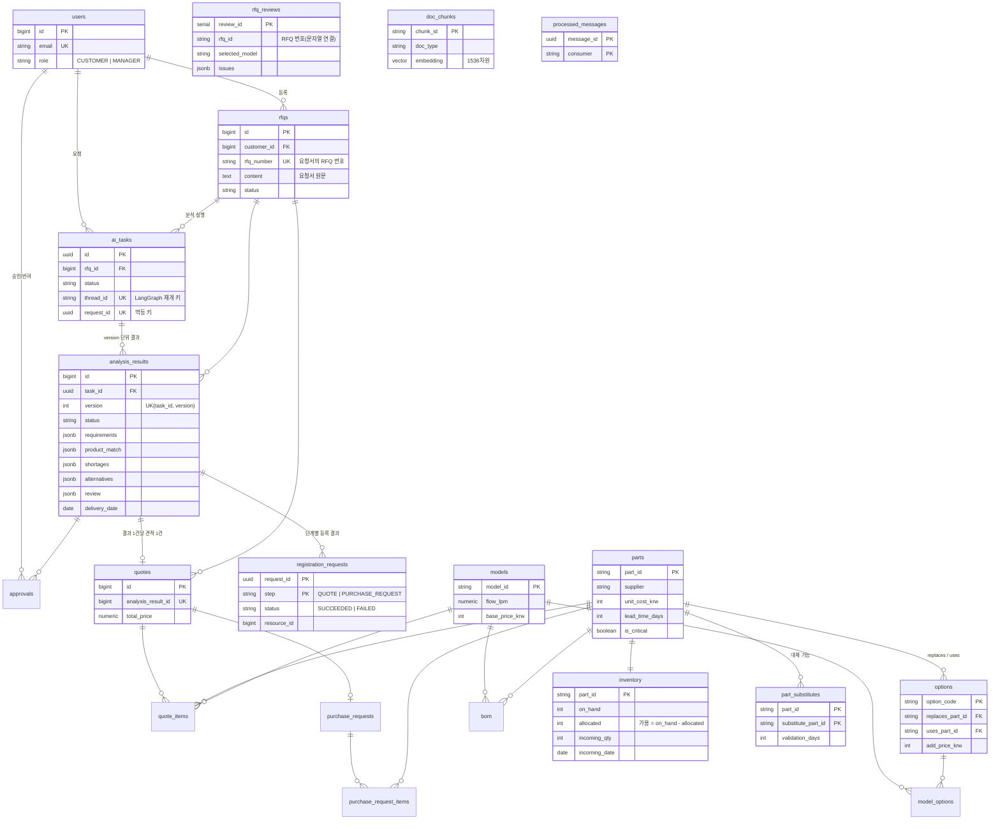

# SupplySync 데이터베이스 설계 (PostgreSQL 16 + pgvector)

스키마의 원본은 [V1__init_schema.sql](../src/main/resources/db/migration/V1__init_schema.sql)이다. 이 문서는 구조를 한눈에 보기 위한 요약이다.
컬럼은 핵심만 적었다. 데모 데이터는 [demo_data.sql](../src/main/resources/db/seed/demo_data.sql)에 있다 (demo 프로파일에서만 적재).

## 출처 구분

| 구분 | 테이블 | 출처 |
| --- | --- | --- |
| **지영님 데이터셋** | `models`, `options`, `model_options`, `parts`, `bom`, `inventory`, `rfq_reviews`, `doc_chunks` | `Input/rfq_dataset/02_postgres/01_schema.sql`. 컬럼명·타입 그대로 |
| **데이터셋 보완 (신규)** | `part_substitutes` | 데이터셋에는 대체 부품 관계가 문서 텍스트로만 있어 테이블로 만들었다. 지영님 확인 필요 |
| **백엔드 워크플로** | `users`, `rfqs`, `ai_tasks`, `analysis_results`, `approvals`, `quotes`, `quote_items`, `purchase_requests`, `purchase_request_items`, `registration_requests`, `processed_messages` | 백엔드 설계 |

데이터셋 대비 변경점:
- `options.replaces_part_id`, `options.uses_part_id`에 `parts` FK를 추가했다. 그래서 시드는 `parts`를 `options`보다 먼저 넣는다.
- `CREATE EXTENSION vector`는 superuser만 가능해서 init 스크립트(관리자 권한)가 먼저 만들고, V1은 `IF NOT EXISTS`로 건너뛴다.
- `doc_chunks`에 `doc_type` 인덱스를 추가했다. 벡터 인덱스(HNSW 등)는 청크가 22개라 두지 않았다.

`rfq_reviews`와 `doc_chunks`는 FK 없이 독립적이다. `rfq_reviews.rfq_id`는 `rfqs.rfq_number`와 문자열로 연결한다.

## 영역별 설명

| 영역 | 테이블 | 비고 |
| --- | --- | --- |
| 사용자 | `users` | 역할은 `CUSTOMER`, `MANAGER`. 인증 단계에서 사용 |
| 카탈로그 | `models`, `options`, `model_options`, `parts`, `bom`, `part_substitutes` | 옵션을 붙이면 `bom`의 `replaces_part_id` 부품이 빠지고 `uses_part_id` 부품이 들어간다. 연결 키는 `model_id` + `option_code` |
| 재고 | `inventory` | 가용 재고 = `on_hand - allocated`. 입고 예정은 부품당 1건(`incoming_qty`, `incoming_date`) |
| 문서 | `doc_chunks` | rag MCP가 읽는다. 임베딩은 적재 작업이 채운다 (현재 NULL). `rag_reader` 계정은 이 테이블만 SELECT 가능 |
| SG1 기록 | `rfq_reviews` | 선정 모델, 옵션, 적합 유형, 이슈 JSON |
| 업무 흐름 | `rfqs`, `ai_tasks`, `analysis_results`, `approvals` | 반려 후 재분석하면 `analysis_results.version`이 올라간다 |
| 등록 결과 | `quotes`, `quote_items`, `purchase_requests`, `purchase_request_items`, `registration_requests` | 아래 "중복 등록 방지" 참고 |
| 메시징 | `processed_messages` | RabbitMQ 소비자가 같은 메시지를 두 번 처리하지 않도록 기록 |

`analysis_results`의 JSONB 컬럼은 데이터셋 정답 JSON 구조를 그대로 담는다.

| 컬럼 | 내용 | 데이터셋 파일 |
| --- | --- | --- |
| `requirements` | 구조화된 요구사항 | `1_parsed_rfq.json` |
| `product_match` | 선정 모델, 옵션, 적합 유형, 단가 | `3_spec_match.json`, `4_output_state.json` |
| `shortages` | 부족 부품 | Subgraph 2 |
| `alternatives` | 대안 비교 (기본안 / 대체 부품 / 분할 납품) | Subgraph 2 |
| `review` | 이슈, 가정, 고객 질의서, 계약 리스크 | `2_validation_issues.json`, `4_output_state.json` |

## 설계 결정

- **중복 등록 방지:** AI가 만든 `request_id`를 `registration_requests(request_id, step)`에 단계별로 기록한다.
  `QUOTE`는 성공하고 `PURCHASE_REQUEST`만 실패해도 같은 `request_id`로 재시도하면 견적은 건너뛰고 구매요청만 처리한다.
  `quotes.analysis_result_id`의 UNIQUE 제약이 DB 수준의 마지막 안전장치다.
- **버전 검사:** 승인과 등록은 승인받은 `analysis_results.version`과 요청의 version이 같을 때만 허용한다.
  승인 후 조건이 바뀌어 재계산하면 이전 결과는 `SUPERSEDED`가 된다.
- **상태 전이는 조건부 UPDATE로:** `UPDATE ai_tasks SET status=... WHERE id=? AND status=<이전 상태>`로 처리하면 락 없이 중복 처리를 막을 수 있다.
- **JSONB 컬럼:** Agent 공통 state가 확정되기 전이라 JSONB로 둔다. 구조가 굳으면 자주 조회하는 값만 컬럼으로 승격한다.
- **상태 값:** PG enum 대신 `VARCHAR + CHECK`를 쓴다. Java enum(`TaskStatus` 등)과 값을 맞춘다.
- **견적 납기는 날짜:** 데모의 납기가 날짜(2026-12-15)라서 `delivery_date DATE`를 쓴다. 기간(일수)은 쓰지 않는다.

## 아직 결정되지 않은 것

- `part_substitutes`를 데이터셋에 정식으로 추가할지 (지영님 확인).
- RFQ 사양서를 텍스트만 받을지 파일(PDF) 첨부까지 받을지. 파일이면 `rfq_attachments` 테이블과 저장소가 필요하다.
- 청크 임베딩 적재 담당과 임베딩 모델. 현재 차원은 1536(OpenAI 계열)으로 가정했다.
- 진행 이벤트 저장 테이블(`task_events`). SSE 재연결 후 이력 표시, FAILED 원인 추적에 필요할 수 있다.
