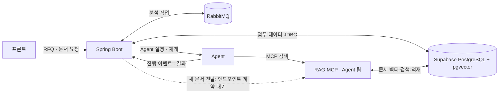

# Supabase · RAG MCP · RabbitMQ 연동 구조

## 현재 합의한 책임

- **Spring Boot:** 프론트 API, RFQ·견적·작업 상태, Supabase 업무 데이터, JWT, Agent 실행·재개, RabbitMQ 분석 작업 흐름을 담당한다. 향후 새 문서를 받는 API를 만들고 Agent 팀의 RAG 적재 엔드포인트로 전달한다.
- **Agent 팀:** Agent 워크플로와 RAG 검색·문서 적재를 담당한다. 새 문서의 청크 분할, 임베딩 생성, 벡터 DB 저장·검색은 RAG 측 책임으로 제안한다. 정확한 적재 API와 DB 쓰기 주체는 계약으로 확정한다.
- **Supabase PostgreSQL + pgvector:** 업무 테이블과 `doc_chunks`를 보관한다. 팀이 확인한 현재 벡터 DB에는 기존 문서의 벡터가 이미 적재돼 있다. 저장 상태와 건수의 자동 검증은 백엔드에 아직 없다.
- **RabbitMQ:** Spring이 Agent 분석 실행·재개 요청을 전달하는 비동기 작업 신호다. outbox·발행·소비·재시도·DLQ 코드는 구현됐고 Agent core가 준비될 때까지 기본 비활성이다. RAG 검색 요청 자체는 전달하지 않는다.

## 두 경로

1. **분석 중 검색:** Agent → RAG MCP → 벡터 DB 검색 → Agent. Spring과 RabbitMQ가 검색 호출을 중계하지 않는다.
2. **새 문서 적재(예정):** 문서 수신 API → Spring의 인증·입력 검증 → Agent 팀의 RAG 적재 엔드포인트 호출 → RAG 측에서 청크 분할·임베딩·벡터 저장. Spring은 결과 ID와 처리 상태를 받아 화면에 알려준다. 이 흐름의 엔드포인트는 아직 구현되지 않았다.

현재 프로젝트의 `demo` 시드는 원본 `03_doc_chunks.sql`을 그대로 적재하므로 **새 Testcontainers DB에서는 벡터가 비어 `PENDING`**이다. 이는 팀이 이미 벡터를 적재한 실제 환경의 상태와 다르다. 운영 DB에 추가 색인 코드를 실행하기 전에 어느 저장소와 계정을 RAG 측이 사용하는지 확인한다.

## Agent 팀과 확정할 계약

### Agent 실행과 진행 상태

- Spring → Agent 제안 경로는 `POST /runs`, `POST /runs/{threadId}/resume`이다. 양방향 HTTP에는 기존 `X-Internal-Api-Key`를 사용한다. 요청·응답, `request_id` 멱등 처리와 실패 재시도 규칙을 확정한다.
- Agent는 노드 시작 시 `POST /internal/tasks/{taskId}/events`에 `{"type":"STEP_START","step":"SUPPLY_CHECK"}`처럼 알린다. Spring은 `step`을 `ai_tasks.current_step`에 저장하며 노드 순서를 추정하지 않는다.
- `trace_url`은 Agent가 선택 필드로 보낼 수 있다. Spring이 저장하고 담당자 작업 상태 API에 반환한다.

### 새 문서 적재

| 항목 | 합의할 내용 |
| --- | --- |
| 호출 방식 | RAG 적재 HTTP 엔드포인트의 URL·메서드와 인증 헤더. 기존 `INTERNAL_API_KEY` 재사용 여부 |
| 입력 | 파일 또는 본문, 문서 종류·출처·버전, 최대 크기, 문서 ID |
| 출력 | 처리 완료 또는 접수 응답, 문서·작업 ID, 상태 조회 방법 |
| 갱신 | 같은 문서 재전송 시 덮어쓰기·중복 방지, 수정·삭제 처리 |
| 실패 | 타임아웃, 재시도 가능 오류, 부분 적재 시 복구 방법 |
| 저장 권한 | RAG 측이 Supabase `doc_chunks`에 직접 쓴다면 그 테이블에만 필요한 최소 권한. 기존 `rag_reader`의 SELECT 권한만으로는 적재할 수 없음 |

## 아직 필요한 구현

- Spring RabbitMQ 경로의 실제 브로커·Agent core 통합 검증과 활성화.
- Agent 서버와 실제 실행·재개·결과 저장·SSE 통합 검증.
- 새 문서 수신 API와 RAG 적재 클라이언트. 계약이 확정되기 전에는 경로와 요청 형식을 고정하지 않는다.
- RAG 측 DB 계정의 테이블 권한, Supabase Data API 노출·RLS 설정 확인.

구매요청 등록은 프로젝트 범위에서 제외한다. 견적 등록 완료가 최종 업무 결과다.
